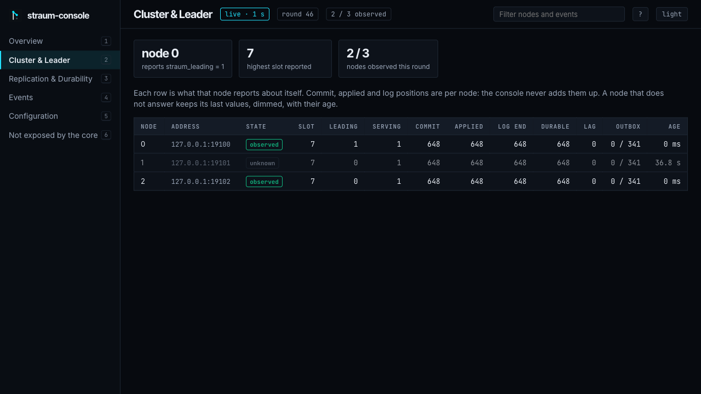
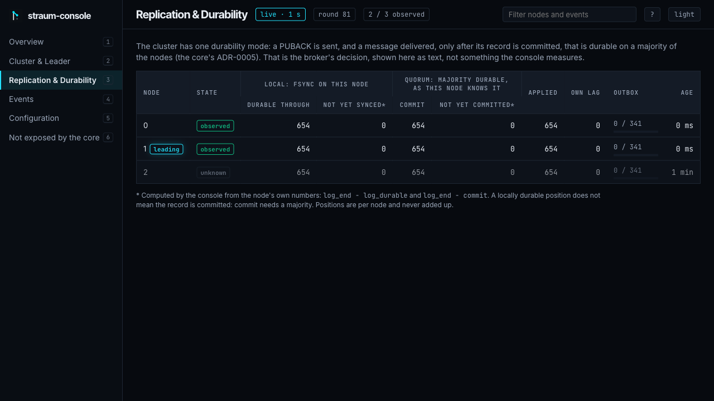
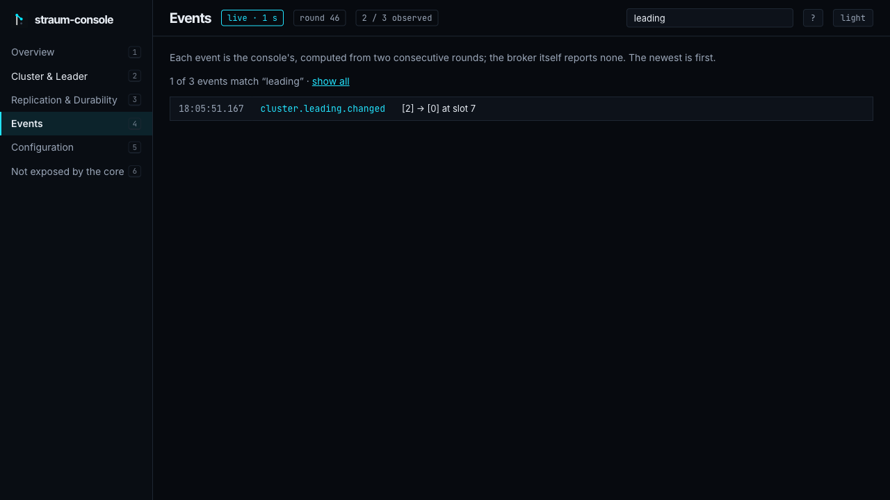
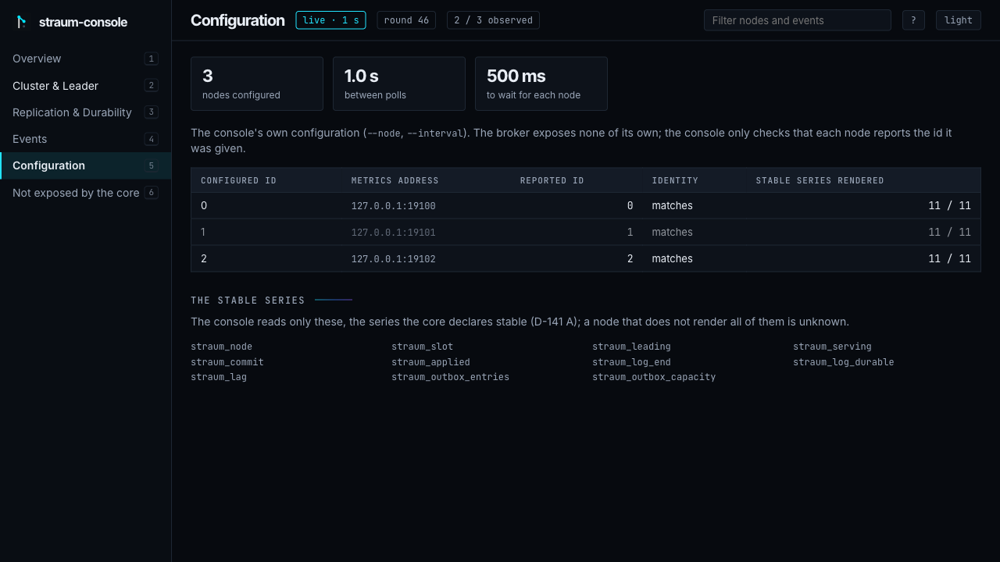
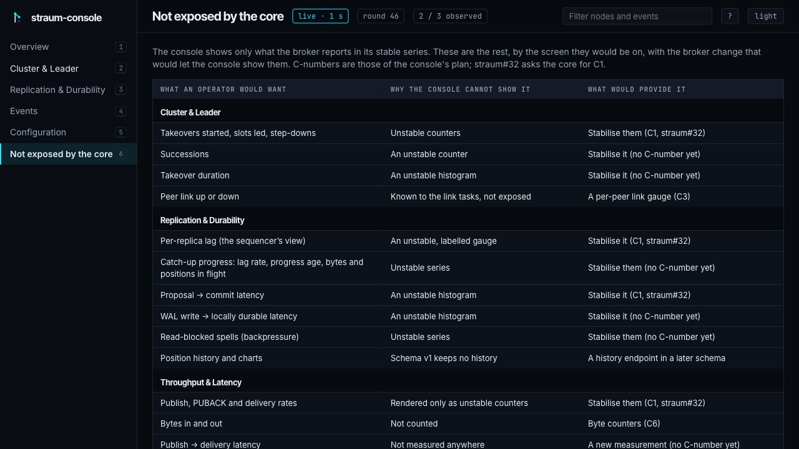
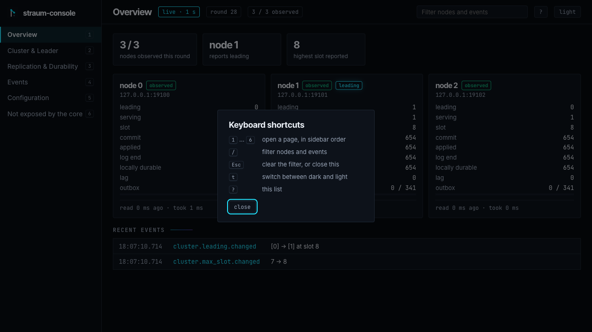

[straum-console](https://github.com/straum-io/straum-console) is the
web console for Straum: every node on one screen, each value with the
node it came from and how old it is. It is early and experimental, like
the broker.

:::caution[Early]
Six pages: Overview, Cluster & Leader, Replication & Durability, Events,
Configuration, and "Not exposed by the core", which lists what the console
cannot show yet and the broker change that would let it.
:::


*Overview: a three-node cluster on one machine, after a handoff, with node
2 stopped. Every value says when it was read.*

## What it is for

Operating a cluster means watching every node at once: who sequences the
log, how far each one has applied and made durable, who stopped
answering. Today that takes `straum-cli status` or a Prometheus scraper.
The console shows it on one live page.

- **Only what the broker promises.** It reads the metrics the broker
  declares stable, through the same Go package as straum-cli. A screen
  the stable metrics cannot fill says so instead of guessing.
- **A source and an age for every value.** A node that stops answering
  turns `unknown`; its last values stay visible with their age, never as
  current.
- **No health verdict.** It reports what each node says, including two
  nodes that both claim to lead.
- **Read-only.** It sends nothing to a node except `GET /metrics`. The
  broker has no administrative API yet, so the console cannot change
  anything.
- **Loopback only.** It refuses any listen address beyond loopback until
  it has authentication. Open it from elsewhere through `ssh -L`.

It runs outside the broker process: the broker will never have a
management UI built in.

## A tour

Each page shows the same live state, one round at a time; nothing on them
is a health verdict. The screenshots are of a real three-node cluster,
taken at different moments, so who leads and who is down differ between them.

**Cluster & Leader.** One row per node with every stable value it
reports. Positions are per node and never added up; a node that does not
answer keeps its last values, dimmed, with their age.



**Replication & Durability.** Local durability (fsync on this node) and
quorum durability (committed by a majority, as this node knows it) in
separate columns, because a locally durable record is not yet committed.
The two "not yet" columns are computed by the console and say so.



**Events.** What changed between two rounds: a node stopping or starting to
answer, a change of who reports leading or of the highest slot, `serving`
flipping, lag starting or clearing, a full outbox. A gap is marked when
events were missed or the console restarted.



**Configuration.** The console's own settings, whether each node reports
the id it was given, and the 11 metrics the broker declares stable, which
are the only ones the console reads.



**Not exposed by the core.** What an operator would want and the console
cannot show yet, why, and the broker change that would provide it.



### Keys and the filter

`1`–`6` open the pages, `/` puts the cursor in the filter, `Esc` clears it,
`t` switches between dark and light, and `?` lists the keys. The filter
narrows whatever the page lists (nodes by id, address, state or error;
events by name, node or text) and stays in the URL, so a filtered view
such as `#/events?q=leading` can be shared. Gap markers stay visible under a
filter, so a filtered list never looks complete when events were missed.



## Install

No release is published yet, so for now build from source. Once one is,
any of these works:

```sh
# Linux or macOS: the release archive for this machine, checked against the
# release's checksums. --user installs into ~/.local; --systemd adds an
# example unit on Linux, not enabled.
curl -fsSL https://raw.githubusercontent.com/straum-io/straum-console/main/install.sh | sh

# Docker on a Linux host, with the host's network:
docker run --network host straumio/straum-console --node 0=127.0.0.1:9100

# The archives for Linux, macOS and Windows on amd64 and arm64:
# https://github.com/straum-io/straum-console/releases
```

`uninstall.sh` removes what `install.sh` installed, the systemd unit
included. The image needs the host's network: the console listens on
loopback only, because it has no authentication, so a published port
(`docker run -p`) cannot reach it.

From source, with Go 1.26:

```sh
git clone https://github.com/straum-io/straum-console && cd straum-console
make build
```

## Try it

You need the metrics endpoint on each node
(`STRAUM_CLUSTER_METRICS_LISTEN`).

```sh
bin/straum-console --node 0=127.0.0.1:9100,1=127.0.0.1:9101,2=127.0.0.1:9102
```

Each node is `id=host:port`, with the id the node should report. Open
http://localhost:8080: the console serves on `127.0.0.1:8080` (`--listen`,
loopback only). The same data is JSON:

```sh
curl -s localhost:8080/api/v1/state     # every node, as last read
curl -sN localhost:8080/api/v1/stream   # the state each round, and what changed
```

On a cluster of several hosts, the console reaches each node's
loopback-only metrics listener as its
[README](https://github.com/straum-io/straum-console#getting-started)
describes. From another machine, forward the console's port: `ssh -L 8080:127.0.0.1:8080
<console-host>`.

## The API

Read-only JSON, version 1:

| Endpoint | What |
|---|---|
| `GET /api/v1/state` | A snapshot of every configured node |
| `GET /api/v1/stream` | Server-sent events: the state after every poll, and each change seen between polls |
| `GET /api/v1/events?after=<id>&limit=<n>` | Changes since an event id, oldest first |

Each change between two rounds is an event: a node that stops or starts
answering, a node that reports another id, a change of which nodes report
leading or of the highest slot, `serving` flipping, lag starting or
clearing, a full outbox, a skipped poll round. A reconnecting stream gets
what it missed, or a `gap` when that is gone or the console restarted. The schema and its compatibility rules are in
[docs/state-json.md](https://github.com/straum-io/straum-console/blob/main/docs/state-json.md).

In a terminal, [straum-cli](../../ecosystem/straum-cli/) `status` shows the
same nodes once.
