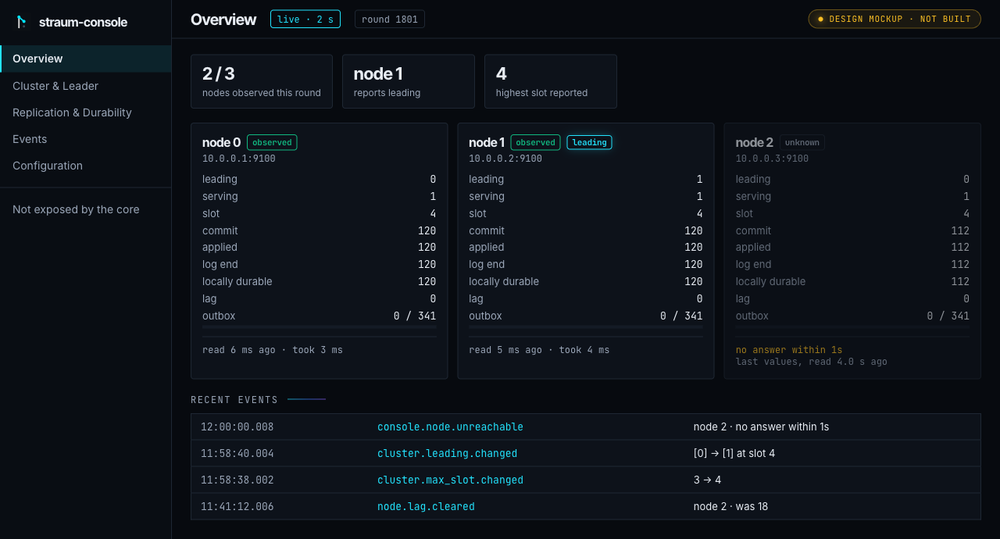

[straum-console](https://github.com/straum-io/straum-console) is the
web console for Straum: every node on one screen, each value with the
node it came from and how old it is. It is early and experimental, like
the broker.

:::caution[Early]
The backend reads the nodes and logs what changes. The HTTP API and the
web pages are not built yet, so there is nothing to open in a browser.
:::



*A design mockup, not a screenshot: what the Overview screen is meant to
show.*

## What it is for

Operating a cluster means watching every node at once: who sequences the
log, how far each one has applied and made durable, who stopped
answering. Today that takes `straum-cli status` or a Prometheus scraper.
The console is meant to show it on one live page.

- **Only what the broker promises.** It reads the metrics the broker
  declares stable, through the same Go package as straum-cli. A screen
  the stable metrics cannot fill says so instead of guessing.
- **A source and an age for every value.** A node that stops answering
  turns `unknown`; its last values stay visible with their age, never as
  current.
- **No health verdict.** It reports what each node says, including two
  nodes that both claim to lead.
- **Read-only.** It sends nothing to a node except `GET /metrics`. The
  broker has no administrative API yet, so the console cannot change
  anything.
- **Loopback only.** It refuses any listen address beyond loopback until
  it has authentication. Open it from elsewhere through `ssh -L`.

It runs outside the broker process: the broker will never have a
management UI built in.

## Try the backend

You need Go 1.26 and the metrics endpoint on each node
(`STRAUM_CLUSTER_METRICS_LISTEN`).

```sh
git clone https://github.com/straum-io/straum-console && cd straum-console
make build
bin/straum-console --node 0=127.0.0.1:9100,1=127.0.0.1:9101,2=127.0.0.1:9102
```

Each node is `id=host:port`, with the id the node should report. It logs,
as JSON lines, each node that turns observed or unknown, a node that
reports another id, and which nodes report leading.

## The API, as designed

The console will serve read-only JSON, version 1:

| Endpoint | What |
|---|---|
| `GET /api/v1/state` | A snapshot of every configured node |
| `GET /api/v1/stream` | Server-sent events: the state after every poll, and each change seen between polls |
| `GET /api/v1/events?after=<id>&limit=<n>` | Changes since an event id, oldest first |

The schema and its compatibility rules are in
[docs/state-json.md](https://github.com/straum-io/straum-console/blob/main/docs/state-json.md).

Until the web pages exist, [straum-cli](../../ecosystem/straum-cli/)
shows the cluster in a terminal.
